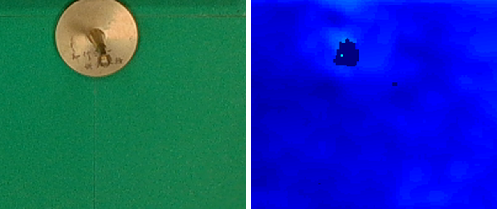
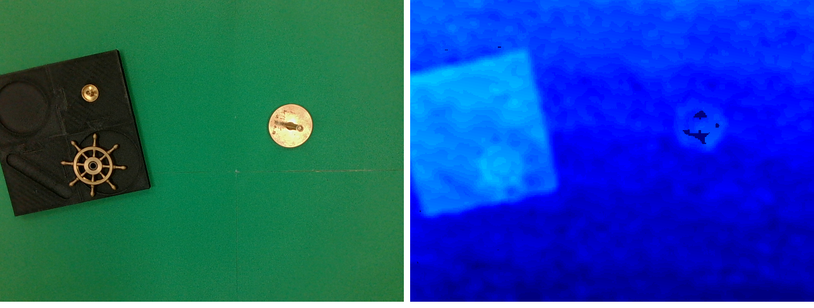
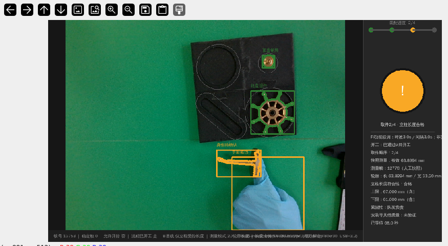
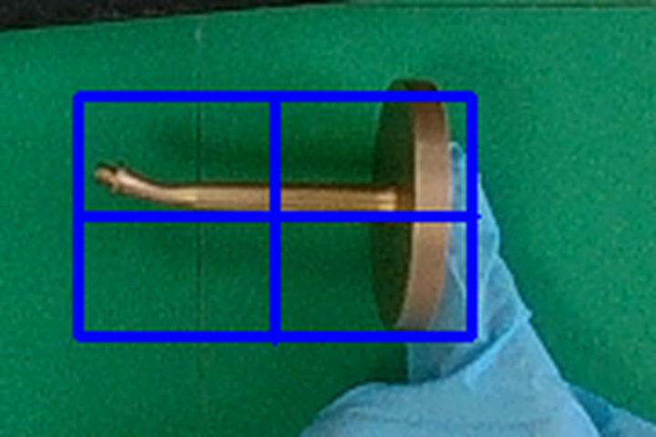
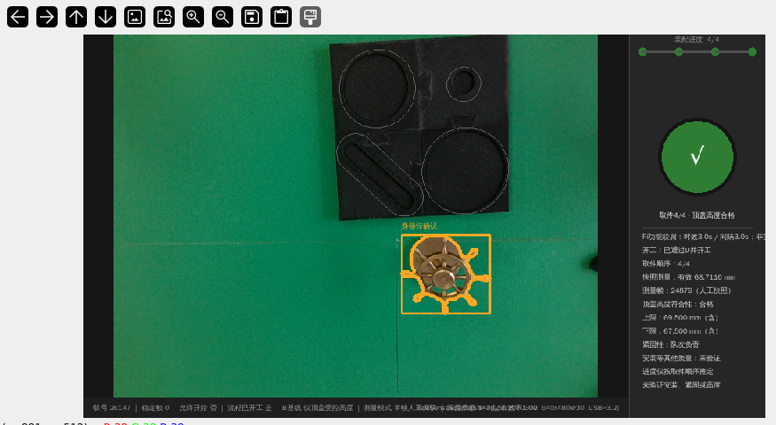
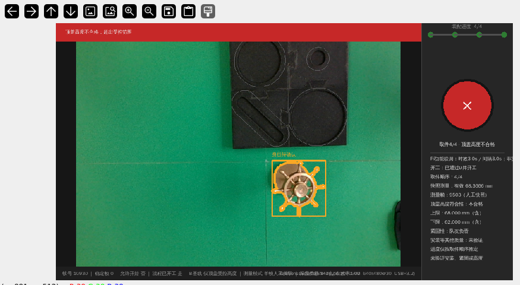
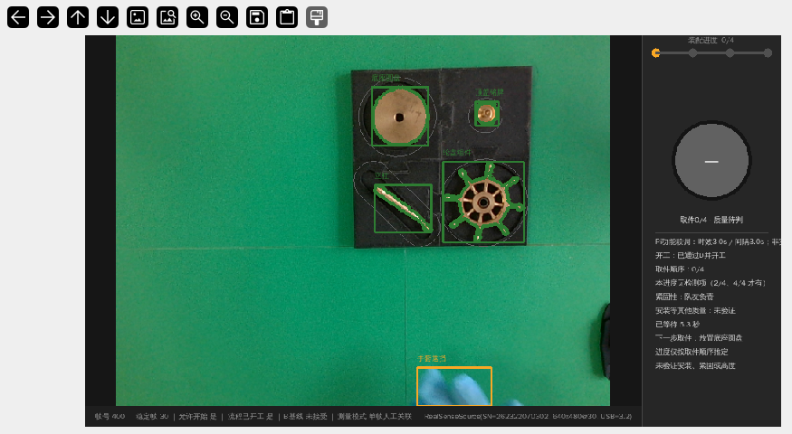
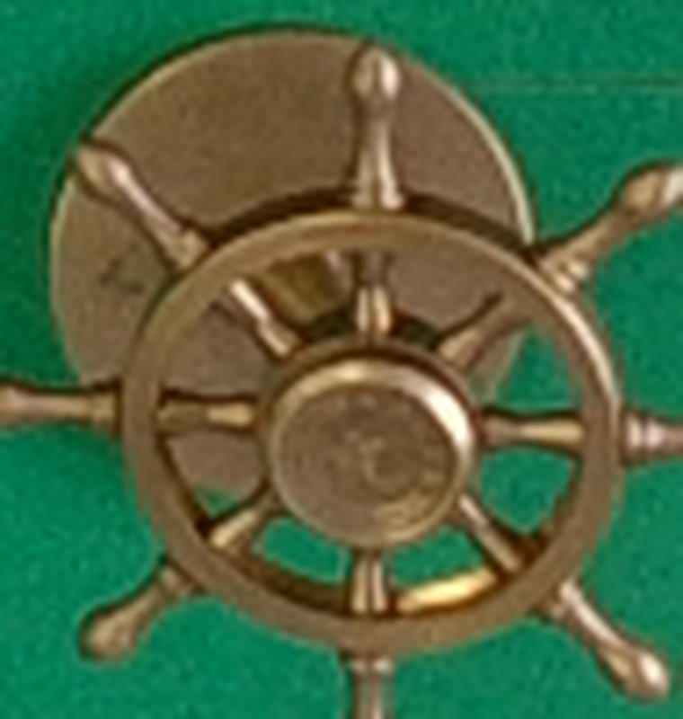

# ABCDE 装配检测系统 —— 实现说明（报告素材）

> 面向"写报告"整理：系统结构、两处测量项的实现、标定与验证数据、遇到的问题与解法、
> 复现命令与文件清单。文中所有数字均为现场实测，不是估计值。

## 1. 系统概述

| 项 | 内容 |
|---|---|
| 计算平台 | Raspberry Pi 4B（4 核 / 2 GB），Raspberry Pi OS（Debian 13）64-bit 桌面 |
| 相机 | Intel RealSense D435，SN 262322070302，USB 3.2，640×480@30 |
| 运行环境 | `~/miniforge3/envs/assembly`（Python 3.12）：pyrealsense2 2.59.1、opencv-contrib 4.14.0、numpy 2.2.6 |
| 被测对象 | 由底座、立柱、轮盘、顶盖四件装配而成的组件 |
| 检测内容 | 取件顺序（4 件）+ 立柱长度（2/4 时）+ 顶盖高度（4/4 时） |
| 检测节拍 | 单帧约 128 ms（约 7.8 fps），其中 A 身份识别 106 ms 为下限 |
| 界面 | 1024×768 屏幕，应用窗口 960×540（X 侧 956×492） |

## 2. 系统结构

### 2.1 五个模块

| 模块 | 职责 | 关键实现 | 主要判据 |
|---|---|---|---|
| A 身份 | 逐帧识别零件身份 | 冻结 v5：分割 + 特征 + 分类 + KCF 追踪 | 只有"本帧可见、未丢失、且与唯一 blob 轮廓完全相等"的轨迹才给身份 |
| B 高度 | 人工同帧测高 | 裸垫参考区拟合三维平面 → 目标区法向高度中位数 | 参考/目标各 ≥50 点、有效率 ≥0.6、高度散布 ≤8 mm、平面残差 ≤2 mm |
| C 观测 | 料盘方向与逐槽占用 | 4 朝向模板 NCC → 掩膜 warp 到料盘坐标 → 逐槽覆盖率 | 方向有效 + 当前帧 + 未过期才发布 |
| D 开工联检 | A 身份 × C 占用 求交 | 轮廓 fillPoly 与槽多边形求交，唯一槽 + 覆盖达标 | 四槽全 match 且连续 3 帧 / 0.3 s 才放行 |
| E 取件顺序 | 顺序推定 | 只认 `match→missing` 边沿 | 越序/多件取走不推进，放回则回退 |

### 2.2 线程模型

```
D-acq（唯一读相机，30 fps）
   └→ D-prep（预分割 ≈98 ms）
        └→ D-check（取预分割结果）
             ├─ A 身份（v5，≈106 ms）┐
             └─ C 观测（4 朝向，≈70 ms）┘→ 关联 / 门禁 / E（≈20 ms）→ 原子快照 → UI
```

A 与 C 并行、预分割与上一帧重叠；三者输出与串行执行逐字段等价，只改调度不改判据。

### 2.3 配置链

判据全部由一条显式 sha256 绑定链决定（任一一环被改都会拒绝启动）：

```
abcde_integration_pi_column_candidate.yaml
 ├─ sequence → process_sequence_size_candidate.yaml (+sha256)
 │   └─ prestart → prestart_check_size_candidate.yaml
 │       ├─ identity.model / policy     → 冻结 A 模型与策略 (+sha256)
 │       ├─ identity.observer           → tray_observation_v2.yaml (+sha256)
 │       ├─ workpiece_sha256 / camera_sha256
 ├─ native_reference → 冻结 B 深度基线 camera.native-depth.json (+sha256)
 └─ height_stages（两种测量项，见 §3）
```

## 3. 两处测量项（2026-10 新增）

原先只有 4/4 之后的一次顶盖测高。本项目把它改成**按取件进度触发的分阶段测量**：
配置里每个阶段绑定一个进度（`at_step`）、一种量法（`mode`）、一条基线与容差、一份授权。

| 阶段 | 触发进度 | 量法 | 窗口 | 说明 |
|---|---|---|---|---|
| 立柱 | **2/4** | `mode: length`（2D 轮廓轴向跨度） | **61.000～67.000 mm**（64±3） | 立柱横放，框"杆 + 底座"整体 |
| 顶盖 | **4/4** | `mode: height`（深度法向高度） | **67.500～69.500 mm**（68.5±1） | 框顶盖中心圆盘 12×12 |

设计要点：

1. **触发权在配置**：`pipeline.inspect_integration()` 用 `stage_for_step(当前取件数)` 取阶段，
   不在代码里写死 4/4；不在允许进度的 `i` 只会提示"需要取件 x/4"。
2. **两条互不干扰**：立柱走 2D（不请求深度、只弹一个选区窗口）；顶盖走原深度法（两个窗口）。
3. **结果按进度存**：测量结果带着 `step` 字段，界面只显示"当前进度对应的那次"，
   回退或继续后旧结果不会冒充当前结论。
4. **判据可追溯**：每个阶段带 `authorization` 文本，记录哪次现场口述产生的基线。

## 4. 关键问题与解法（报告里的"难点"部分）

### 4.1 立柱顶端测不到深度 → 改用长度法

原方案沿用 B 的深度法量"立柱顶端到台面的高度"，实测**完全不可行**。证据（2026-10-28）：

- 立柱所在约 40×20 px 区域，**有效深度点 = 0**，而周围每一格都是 64/64 满格；
- 全画面最大高度只有 **18.9 mm**（另一个机位 19.9 mm），不存在 64 mm 的面；
- 换过 12×12、10×10、8×8、6×6 四种框，读数分别是 3.49 / 无效 / 5.30 / 3.75 mm，全部是台面高度。

结论：立柱是 Ø15 mm 的高反光细杆，主动红外被镜面反射掉，D435 打不出点。
**改法**：横放后量长度——长度只存在于图像平面内，用标定好的 mm/px 量金属掩膜即可，
不受杆身高反光影响。

### 4.2 毫米比例偏差 12% → 现场用卡尺标定

流程里 `TrayMap.mm_per_px()` 给出 **0.73097 mm/px**，但用卡尺核对发现它偏大约 12%：

| 口径 | 画面 | 卡尺 | 反推 mm/px |
|---|---|---|---|
| 整体（杆 + 底座） | 100.3 px | 64.0 mm | **0.638** |
| 杆身 | 88.1 px | 58.0 mm | 0.658 |

两个口径都落在 0.65 附近，说明标定文件的 homography 与当前机位不符。
**改法**：长度阶段写 `mm_per_px: 0.638`（现场标定值），并在面板上显示比例与其来源；
未写该字段时仍退回 TrayMap 并标注 `tray_map`，便于排查。顶盖高度用深度绝对毫米，不受影响。

### 4.3 皮肤会被判成黄铜

黄铜掩膜用的是"饱和度 + 明度"双阈值，**人手皮肤同样满足**。实测把"零件 + 手"当成一块，
长度被量成 150 mm。蓝色手套因色相不同不受影响。
**约定**：测量时手必须离开测区（已写进操作流程）。

### 4.4 T 形件不能直接取最小外接矩形

立柱 + 底座是 T 形：最小外接矩形会被底座的两个角撑大（98.4 px ↔ 73 mm）。
**改法**：取最大连通域的**轴向跨度**（主轴投影长度），并对"像素中心 → 物理边缘"补 1 px；
同样的数据下 88.1 px → 64.4 mm，与卡尺一致。

### 4.5 1 像素 ≈ 0.64 mm，边界必须约定

0.64 mm/px 下，轮廓多框进底座就会多算一个底座的厚度（约 9 mm）。
**约定**：长度阶段框"杆 + 底座"整体（与 64 mm 的口径一致）；只框杆身会读成 56 mm。

### 4.6 测量重复性与窗口宽度的关系

同一天顶盖三次读数：68.3316 / 68.0316 / 68.7116 mm，**极差 0.68 mm**；
长两次：62.50（圆盘倾斜）/ 63.90（圆盘较平），差 1.4 mm。
±1 mm 的窗口只有 2 mm 宽，重复性已接近窗口宽度——这是后续要改进的点（见 §7）。

## 5. 验证数据

### 5.1 立柱长度（2/4，现场实测）

| 日期/姿态 | 读数 | 卡尺 | 偏差 |
|---|---|---|---|
| 10-29 圆盘倾角较大 | 62.5048 mm | 64.0 mm | −1.50 mm |
| 10-29 圆盘较平 | **63.8994 mm** | 64.0 mm | **−0.10 mm** |

### 5.2 顶盖高度（4/4，现场实测）

| 次序 | 读数 | 均值 | 极差 |
|---|---|---|---|
| 1 | 68.3316 mm | 68.36 mm（三次均值） | 0.68 mm |
| 2 | 68.0316 mm | | |
| 3 | 68.7116 mm | | |

三次均值 68.36 mm 与设定基线 68.5 mm 相差 0.14 mm，说明基线选取合理；
但 0.68 mm 的极差说明单次读数不足以支撑 ±1 mm 的窗口。

### 5.3 软件验证

- `tests/run_all.py`：**33 个测试模块全部通过**（含新增 `test_height_stages`，42 条断言）；
- `preflight_pi.py --integration config/abcde_integration_pi_column_candidate.yaml`：全部通过；
- 界面实测：0/4 显示"本进度无检测项（2/4、4/4 才有）"；2/4 显示"立柱长度符合性"与 61.000～67.000；
  4/4 显示"顶盖高度符合性"与 67.500～69.500；超差时红条 + 写明是"立柱长度"还是"顶盖高度"。

## 6. 操作流程

1. 四件放回料盘 → 手离开 → 等右上角出现 `已通过D并开工`；
2. 取 **底座 → 立柱**，把立柱拧进底座后**横放**到台面，手离开；
3. 进度到 `2/4` → 按 `i` → 只弹一个窗口 `Target: … COLUMN length` → 框**杆 + 底座整体** → Enter；
   面板出 `轮廓：长 xx.xx mm / 宽 xx.xx mm`、`立柱长度符合性`、`长度比例：0.6380 mm/px（现场标定）`；
4. 继续取 **轮盘 → 顶盖** → 到 `4/4` → 按 `i` → 依次框**裸垫参考区 60×60** 与**顶盖中心圆盘 12×12**；
   面板出 `顶盖高度符合性` 与上下限；
5. `r` 复位整轮，`q` 退出。

## 7. 已知限制与后续工作

1. **测量重复性 vs 窗口**：顶盖三次极差 0.68 mm，±1 mm 窗口余量偏薄。
   建议改为"连测 3 帧取中位数 + 极差 >0.8 mm 判测量不可信"，再考虑收紧窗口。
2. **毫米比例来源不一致**：TrayMap 0.731 与现场 0.638 差 12%，说明 homography 过期；
   彻底解决应重跑 `calib/c3_tray_homography.py`。目前长度阶段用现场标定值规避。
3. **长度读数受摆放姿态影响**：圆盘倾斜时读数偏小（62.50 vs 63.90）。
   操作上要求底座平贴台面；若要更稳，可改为量杆身（边界更清晰）。
4. **皮肤误检**：手必须离开测区。
5. **立柱无法用深度法**：若将来要恢复"高度"口径，需要给杆顶贴哑光靶标或改机位/加柔光。

## 8. 文件清单（本次新增/改动）

| 文件 | 类型 | 说明 |
|---|---|---|
| `assemvision/core/length.py` | 新增 | 2D 长度测量（最大连通域 + 轴向跨度 + 1 px 边缘修正） |
| `assemvision/integration.py` | 改动 | 阶段机制（`height_stages`）、`mode: height/length`、阶段级 `mm_per_px`、界面文案 |
| `assemvision/pipeline.py` | 改动 | 按进度取阶段；`_inspect_length()` 分支（单测区、不请求深度） |
| `app.py` | 改动 | 启动横幅按配置列出各阶段 |
| `config/abcde_integration_pi_column_candidate.yaml` | 新增 | 分阶段候选：2/4 立柱长度、4/4 顶盖高度 |
| `deploy/pi/run_abcde_column.sh` | 新增 | 对应入口 |
| `tests/test_height_stages.py` | 新增 | 42 条断言（阶段解析、违规拒绝、比例优先、长度法边界） |
| `tools/pi_diagnostics/d435_height_probe.py` | 新增 | 深度探针：整幅高度地图 + 热力图 |
| `tools/pi_diagnostics/d435_depth_void_probe.py` | 新增 | 深度可用性探针：逐格"高度 + 有效点数" |
| `tools/pi_diagnostics/length_probe.py` | 新增 | 一次性长度测量（不跑流程，直接开相机） |
| `docs/2026-10-28_立柱测高与深度探针.md` | 新增 | 高度法失败的完整记录 |
| `docs/2026-10-29_立柱长度检测.md` | 新增 | 长度法的实现、标定与操作约定 |
| `docs/HANDOVER.md` | 改动 | 操作流程、配置链、参数表、待办同步 |
| `tools/pi_diagnostics/preflight_pi.py` | 改动 | 有 `height_stages` 时打印全部阶段 |

所有改动文件均保留 `*.bak_20261028` 备份，可逐文件回退。

## 9. 复现命令

```bash
cd ~/assembly_vision

# 启动（分阶段：2/4 立柱长度 + 4/4 顶盖高度）
./deploy/pi/run_abcde_column.sh

# 只测顶盖（旧候选，不含立柱阶段）
./deploy/pi/run_abcde.sh

# 配置链自检
~/miniforge3/envs/assembly/bin/python tools/pi_diagnostics/preflight_pi.py \
    --integration config/abcde_integration_pi_column_candidate.yaml

# 回归
PYTHONIOENCODING=utf-8 ~/miniforge3/envs/assembly/bin/python tests/run_all.py

# 诊断（会独占相机，先停 app）
pkill -f 'app[.]py --integration'
~/miniforge3/envs/assembly/bin/python tools/pi_diagnostics/d435_height_probe.py
~/miniforge3/envs/assembly/bin/python tools/pi_diagnostics/d435_depth_void_probe.py --region 400 150 520 260 --cell 8
~/miniforge3/envs/assembly/bin/python tools/pi_diagnostics/length_probe.py
```

## 10. 附图（全部为现场实拍）

### 图 1 深度探针：左为彩色画面，右为高度热力图（越亮越高）



全图最大高度 18.9 mm，装配区没有任何 64 mm 的面——这是"立柱高度用深度法测不了"的直接证据。

### 图 2 深度探针：逐格有效点数地图



立柱所在约 40×20 px 区域有效点 = 0（黑色空洞），周围满格；说明不是"没装"，而是"打不到深度"。

### 图 3 立柱长度实测：63.8994 mm，合格



2/4 阶段，框"杆 + 底座"整体；面板显示 `轮廓：长 63.8994 mm / 宽 33.20 mm` 与判定结果。

### 图 4 立柱长度测区框选



测区含底座（与 64 mm 口径一致）；手套在框内但被色相分离排除，不影响测量。

### 图 5 顶盖高度实测：68.7116 mm，合格



4/4 阶段深度法；窗口 67.500～69.500（68.5±1）。界面顶部为绿色对勾。

### 图 6 顶盖高度：旧窗口（62～68）下的"贴边不合格"



68.33 mm 在旧窗口下判不合格、在新窗口（≤69.5）下合格——报告里可作为"判据窗口选择影响结论"的实例。

### 图 7 启动状态：四件识别正常、D 已放行



ABCDE 的 A（身份）+ C（占用）+ D（开工联检）在正常画面下的表现。

### 图 8 顶盖目标区放大（12×12 选区依据）



顶盖中心圆盘约 28 px 宽，12×12 的测区可稳定落在平面内。


